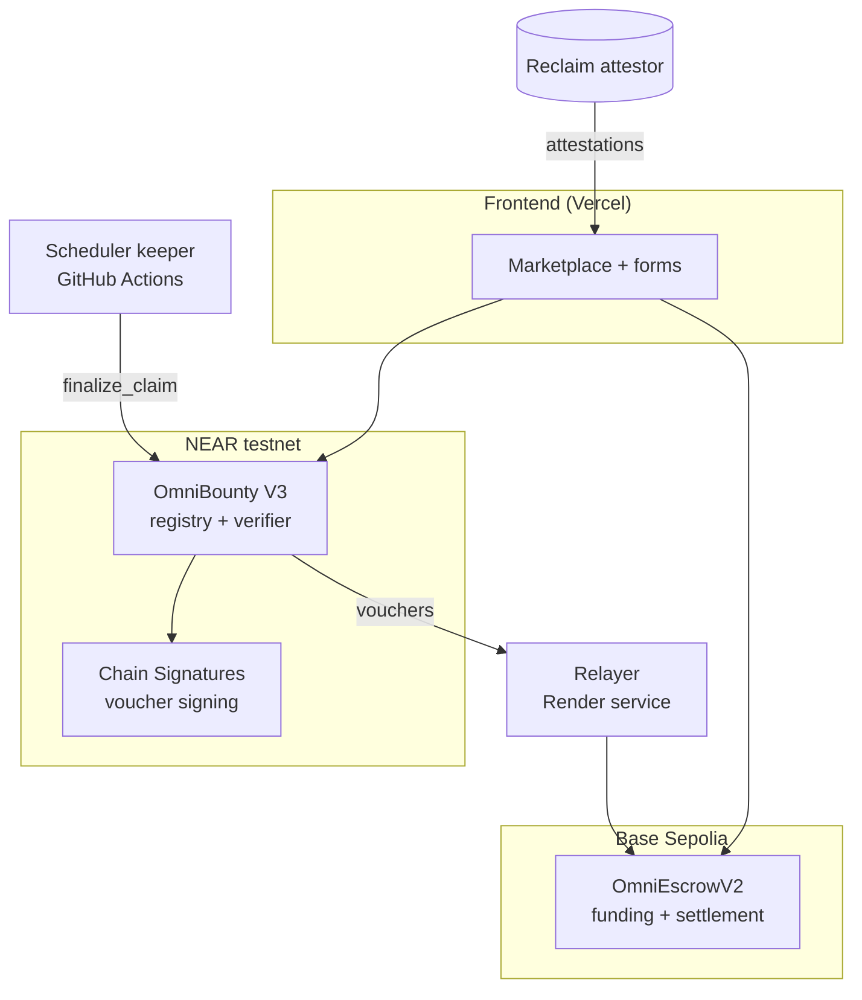
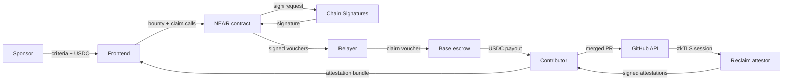
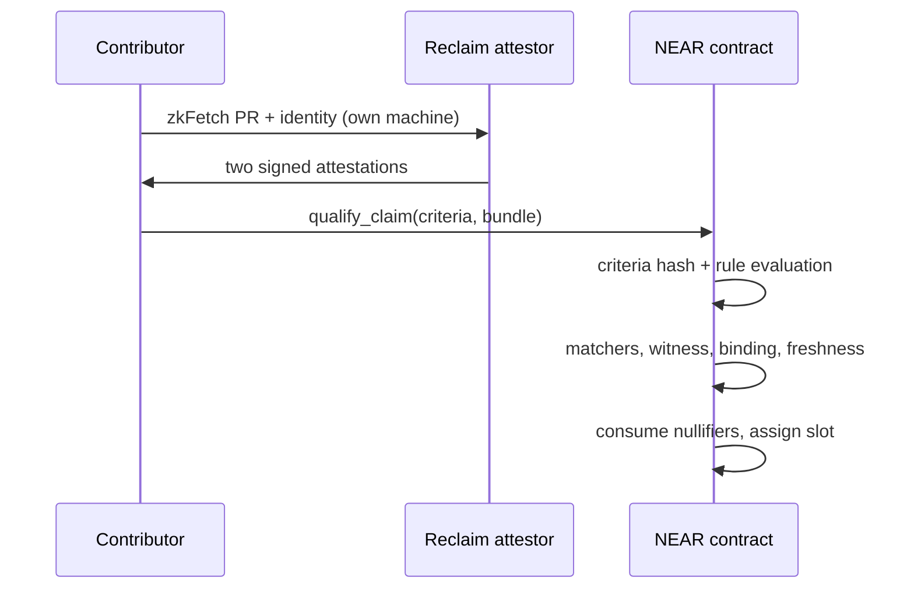
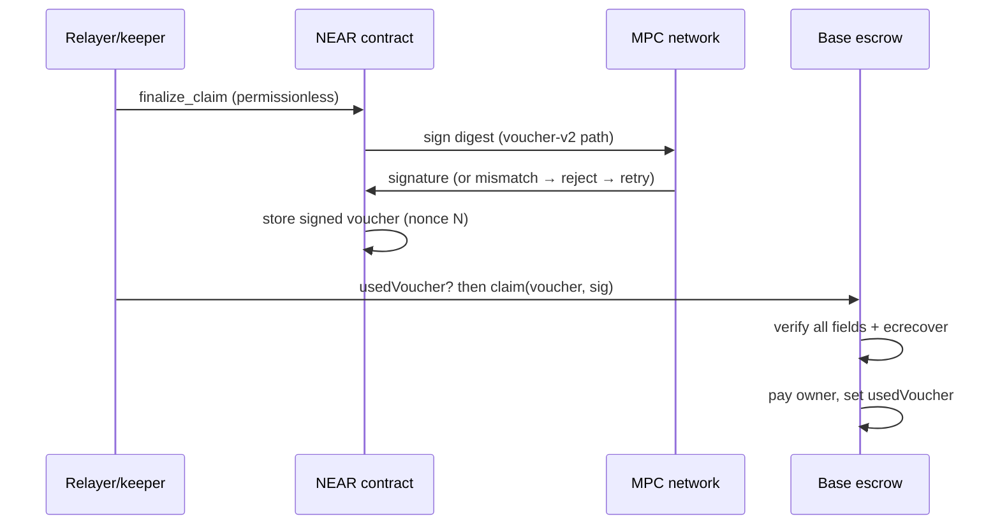

# OmniBounty

**A cross-chain bounty marketplace that connects verifiable work to guaranteed, on-chain rewards.**

OmniBounty enables sponsors to create funded bounties with predefined, verifiable acceptance criteria and allows contributors to earn rewards by completing qualifying work. Instead of relying entirely on manual verification and trust-based payments, OmniBounty connects cryptographic evidence of completed contributions to an independently verified escrow payout.

Sponsors define and commit their acceptance criteria on NEAR Protocol, while USDC rewards are held in a Base escrow. Contributors submit Reclaim zkTLS attestations proving qualifying GitHub activity and identity. NEAR verifies claims and authorizes payout vouchers through its Chain Signatures MPC infrastructure, which the Base escrow independently verifies before releasing payment.

Live application: <https://omnibounty.vercel.app/> (NEAR testnet × Base
Sepolia, testnet USDC only — not mainnet production infrastructure.)

> **Status.** The system works end to end on public testnets. The latest
> completed demonstration is **Run 5** (2026-11-14): a fresh bounty went
> from creation to 1-USDC settlement with separate deployer, sponsor, and
> contributor wallets operated by the project team. The demo was
> self-funded and self-claimed by the same operator and does not
> demonstrate independent sponsor–contributor participation. Demo
> criteria verify a merged PR and GitHub identity, not that the code
> solves a task. Evidence: `evidence/e2e-run5/E2E-RUN5.md`.

## Contents

- [The Problem](#the-problem)
- [Our Solution](#our-solution)
- [What it is and why](#what-it-is-and-why)
- [Why NEAR Protocol?](#why-near-protocol)
- [Architecture](#architecture)
- [How it works](#how-it-works)
- [Claim verification](#claim-verification)
- [Payout and settlement](#payout-and-settlement)
- [Contracts and links](#contracts-and-links)
- [Run 5 evidence](#run-5-evidence)
- [Verification methods](#verification-methods)
- [Technology](#technology)
- [Roadmap](#roadmap)
- [Documentation index](#documentation-index)
- [Limitations, trust assumptions, and security disclosures](#14-limitations-trust-assumptions-and-security-disclosures)
- [Hackathon declaration](#hackathon-declaration)
- [Built For](#built-for)
- [License](#license)

## The Problem

Bounty platforms connect sponsors who fund work with contributors who
perform it, but three gaps recur across traditional bounty workflows:

1. **Unverifiable work completion.** Determining whether a contribution
   satisfies the sponsor's requirements often depends on manual
   maintainer reviews. Acceptance criteria may be subjective, informal,
   or inconsistently enforced, leaving contributors unsure what exactly
   will qualify.
2. **Unreliable payout execution.** Even after contributors complete and
   submit qualifying work, they may still depend on sponsors or
   intermediaries to initiate payment. Accepting the work and receiving
   the reward are separate actions, so nothing guarantees they happen
   together.
3. **Disconnected verification and payment.** Evidence that a
   contribution meets predefined requirements is often separate from the
   mechanism that releases the reward. This creates a trust gap between
   proving that work qualifies and ensuring that payment reaches the
   rightful contributor.

Together these problems create a need for a system that connects
predefined acceptance criteria, independently verifiable contribution
evidence, and enforceable reward settlement.

## Our Solution

OmniBounty connects verifiable contribution evidence to enforceable
reward settlement through a cross-chain bounty protocol.

Sponsors define and cryptographically commit acceptance criteria on NEAR
before funding their bounties. Contributors submit Reclaim zkTLS
attestations proving their GitHub pull requests were merged and binding
the contribution to their GitHub identity.

The NEAR smart contract independently verifies the submitted criteria
and attestations before qualifying a claim. Once the claim is finalized,
NEAR Chain Signatures MPC authorizes a payout voucher for the
corresponding reward. The Base escrow independently verifies the voucher
and releases the USDC payment to the bound recipient.

This creates a verifiable path from predefined requirements and
demonstrated contribution to authorized payment, reducing reliance on
subjective approval and manual payout execution.

**Prove the work. Verify the claim. Authorize the payment. Settle the reward.**

## What it is and why

OmniBounty is a bounty marketplace where **payment is conditional on
machine-verifiable evidence of merged work**. A sponsor defines *what
counts* as a cryptographic criteria document, locks the reward in escrow,
and any contributor who lands a qualifying merged pull request can claim
it by presenting Reclaim zkTLS attestations of the merge and of their
GitHub identity. While the escrow's MPC signer still names the MPC
derivation, no relayer or caller can redirect or double-pay a signed
voucher: every settlement check runs on-chain or against signed
attestations. That guarantee depends on the signer not being rotated —
and the relayer key currently doubles as the escrow owner, so its
compromise could rotate the signer and forge vouchers (see operational
note above and §14).

Conventional GitHub bounty systems decide *who earned a reward* and *pay
them* through manual, trusted steps: a maintainer eyeballs a PR, then
someone with a wallet sends funds. Verification is subjective (no pinned
definition of what qualified), payouts are slow and trust-based, and
identity is asserted rather than proven. OmniBounty replaces all three
with verifiable artifacts: a hashed criteria document committed before
funding, zkTLS attestations of the GitHub API responses themselves, and
an escrow that only pays a recipient named in an MPC-signed voucher.

## Why NEAR Protocol?

OmniBounty separates claim verification from reward settlement. The NEAR contract is responsible for deciding whether a contribution qualifies. It commits each bounty's acceptance-criteria hash, verifies the submitted Reclaim attestations against the configured matchers and witness set, enforces freshness, binds the GitHub PR author to the verified GitHub identity and payout recipient, and consumes nullifiers to prevent proof reuse.

Once a claim is finalized, NEAR Chain Signatures authorizes a payout voucher using a fixed derivation path. The Base escrow independently verifies the voucher signature with `ecrecover`, checks its own settlement conditions and replay state, and releases the USDC reward to the bound recipient.

Chain Signatures is the key architectural reason for choosing NEAR. It allows the NEAR contract to request signatures from a decentralized MPC network for an externally derived Base account, without storing or relying on a conventional private key for that account. The relayer submits signed vouchers; it does not ordinarily authorize them.

There is an important trust assumption: the deployed relayer's EVM key also controls the Base escrow's owner privileges. A compromise could allow signer rotation and voucher forgery or redirection for funded, unclaimed slots. This limitation is disclosed in the security section and is a priority for production hardening.

We did not choose NEAR because Base cannot verify Reclaim attestations. Reclaim also provides EVM verification options, so a Base-only design is possible. We chose NEAR to keep bounty criteria and claim-verification logic on a dedicated contract, keep the Base escrow focused on funding and settlement, and use NEAR's native Chain Signatures infrastructure to authorize cross-chain payouts without a conventional custodial key for the external signer.

## Architecture

Each component owns one job and trusts the others only through verified
artifacts:

- **Next.js frontend** — marketplace, bounty/claim forms, settlement
  tracking. Reads chain views, writes only through the user's wallets;
  holds no keys.
- **NEAR V3 contract** (`omnibounty-v3.testnet`) — bounty registry,
  criteria commitments, attestation verification, nullifiers, MPC
  dispatch. Cannot observe Base.
- **Base escrow** (`OmniEscrowV2`) — USDC funding, voucher settlement,
  refunds. Trusts only MPC signatures plus its own state; cannot
  observe NEAR.
- **Reclaim zkTLS attestations** — attestor-signed claims over observed
  GitHub API responses (PR + identity). The trust root is the pinned
  epoch-1 witness set.
- **NEAR Chain Signatures (MPC)** — co-signs voucher digests under the
  `omnibounty-voucher-v2` derivation path. No hot key exists.
- **EVM relayer** (Render service) — discovers signed vouchers,
  re-validates them, checks `usedVoucher` ground truth, submits `claim`.
  Currently also the escrow owner (see §14).
- **NEAR scheduler/keeper** (GitHub Actions, active but slow-cadence) —
  runs `finalize_batch.mjs` for matured claims with its own NEAR
  operator key; the relayer's `finalizePass` is the fast path.



## How it works

1. A sponsor writes criteria (repo, merge policy, reward slots) and walks
   a five-step flow: register on NEAR → create on the Base escrow →
   approve USDC → fund → confirm funding on NEAR.
2. A contributor merges a qualifying PR, generates two Reclaim
   attestations on their own machine, and pastes them into the claim
   form — one wallet approval submits `qualify_claim`, which checks the
   criteria commitment, the attestation matchers, the identity binding,
   and replay nullifiers.
3. Anyone finalizes the matured claim (`finalize_claim` is
   permissionless); the contract dispatches an MPC signing request and
   the signed voucher lands on-chain.
4. The off-chain relayer re-validates the voucher and submits it to the
   Base escrow, which pays USDC to the attestation owner.


## Claim verification

The contributor generates two attestations on their own machine with
`frontend/scripts/prove.mjs` (PR endpoint, public session) and
`prove_identity.mjs` (GitHub `/user`, own token kept inside the private
TLS session, never in signed parameters or on-chain), then pastes the
bundle into the claim form, which preflights it with read-only
`dry_qualify` before the single `qualify_claim` approval. The contract
re-validates the submitted criteria document, re-hashes it against the
committed hash, evaluates its rules (repo, merge policy, files, labels,
checks, reviews, windows where configured), checks attestation
matchers/headers/epoch/witness set, binds PR author to identity and
owner to recipient, enforces freshness windows, and consumes nullifiers
— reuse fails with `IDENTIFIER_REPLAY`.



## Payout and settlement

`finalize_claim` is permissionless once the challenge window passes; the
contract dispatches the digest to Chain Signatures, validates the
response shape in `on_voucher_signed`, and either stores the signed
voucher or emits `voucher_rejected` and releases the slot for retry
(Run 5 needed two retries — retry-shaped by design). The relayer
discovers the voucher, re-validates shape, chain, escrow, expiry,
digest, signature, and schedule consistency, checks `usedVoucher`
ground truth, and submits `claim(voucher, v, r, s)`; the escrow
re-checks everything including MPC ecrecover, pays USDC to the
attestation owner, sets `usedVoucher`, and emits `VoucherClaimed`.



## Contracts and links

| Contract | Network | Address |
|---|---|---|
| OmniBounty V3 | NEAR testnet | `omnibounty-v3.testnet` |
| OmniEscrowV2 | Base Sepolia (84532) | `0x63391c272A49c30f79eb6c3d8E10F0652Bb0F767` |
| USDC (Circle, 6 decimals) | Base Sepolia | `0x036CbD53842c5426634e7929541eC2318f3dCF7e` |
| Chain Signatures (MPC) | NEAR testnet | `v1.signer-prod.testnet` (derived signer `0x4b20…A2f9`) |

Explorers: [NEAR contract](https://testnet.nearblocks.io/address/omnibounty-v3.testnet) ·
[Base escrow](https://sepolia.basescan.org/address/0x63391c272A49c30f79eb6c3d8E10F0652Bb0F767) ·
[USDC](https://sepolia.basescan.org/address/0x036CbD53842c5426634e7929541eC2318f3dCF7e) ·
[Run 5 payout tx](https://sepolia.basescan.org/tx/0x3f171afb6649b3d0432bd4eaabdb90ede5fd2e871248a6153b89edc5024037e1) ·
[Repo PR #2 (Run 5 contribution)](https://github.com/Web3smallie/omnibounty/pull/2).

## Run 5 evidence

Run 5 (2026-11-14) took bounty `414201122891941` from creation to
settlement: fresh NEAR sponsor (`run5sponsor.testnet`) and contributor
(`run5contributor.testnet`) wallets, fresh merged PR #2, fresh Reclaim
sessions (new PR identifier `0x4555…`), NEAR claim, MPC-signed voucher
(nonce 7, digest `0x15a3…dc7e0`), and 1-USDC settlement by the deployed
Render relayer ([payout tx](https://sepolia.basescan.org/tx/0x3f171afb6649b3d0432bd4eaabdb90ede5fd2e871248a6153b89edc5024037e1),
block 58721205). Full record with every transaction hash, wallet, and
verification step: `evidence/e2e-run5/E2E-RUN5.md` (17/17 checksums
verify).

Run 5 demonstrates the deployed contracts, live MPC signing, and escrow
settlement working together on real testnets. It does not demonstrate
independent sponsor–contributor participation (team-operated wallets),
mainnet readiness, or criteria beyond merge + identity binding.

## Verification methods

Four complementary methods (detail in `JUDGES.md` §§3b–3d) — do not
confuse what each proves:

| Method | Proves | Does not prove |
|---|---|---|
| Live Run 5 demo | Live contracts + MPC + escrow on real testnets | Production readiness, independent participation |
| Recorded Rust evidence | A completed Rust run (133 unit, 6 XSuite, clean lints) | Independent reproduction (inspect only) |
| Local E2E replay | JS/TS logic + full scenario flow on a local EVM (Node-only) | Rust sources, live chains, live MPC (uses test keys) |
| Full test execution | Everything rebuilt and run from source on your machine | Live testnet behavior |

Reviewer replay (fresh clone, Node 22+ only — no Rust, no Foundry):

```sh
cd relayer && npm ci
cd ../integration && npm ci
cd ..   # back to the repository root
npm run e2e:local -- --no-regen   # 7/7 scenarios, frozen fixture
```

This is a local replay on an in-process EVM with fixture-embedded
vouchers — not live testnet execution, not Rust verification, and not
live MPC signing.

## Technology

| Layer | Stack |
|---|---|
| Frontend | Next.js 15 + React 19, NEAR Wallet Selector, `ethers` 6 |
| NEAR contract | Rust, `near-sdk` 5.1 |
| Base escrow | Solidity 0.8.24, Foundry 1.9.0 |
| Attestations | Reclaim zkFetch attestations, single testnet attestor |
| Signing | NEAR Chain Signatures (MPC, no hot key) |
| Settlement | Circle USDC on Base Sepolia |
| Relayer | Node service (Render), 30 s polls, `/health` endpoint |
| Testing | `cargo test` + XSuite, Foundry, `node:test`, Hardhat local E2E |

## Roadmap

Planned direction only — no dates, no commitments, none of this is
implemented:

1. Independent sponsor and contributor participation.
2. Better criteria authoring and stronger task-specific completion requirements.
3. Evidence integrations beyond GitHub.
4. Structured dispute and review workflows.
5. Production readiness: independent security audit, stronger administration, operational resilience and monitoring.
6. Evaluating additional networks after stabilizing the existing cross-chain flow.

## Documentation index

- [`JUDGES.md`](JUDGES.md) — judge verification guide and terminal runbook: installation (§4), test suites (§3), live E2E steps (§7), recorded-proof fallback (§8), trust model (§10), attack tests (§11), limitations (§12).
- [`evidence/e2e-run5/E2E-RUN5.md`](evidence/e2e-run5/E2E-RUN5.md) — Run 5 live record: every transaction hash, wallet, proof reference, and verification step (checksums in `SHA256SUMS`).
- [`evidence/rust-verification/`](evidence/rust-verification/) — recorded Rust test evidence (Method 2).
- [`docs/v3/NEAR_V3_DESIGN.md`](docs/v3/NEAR_V3_DESIGN.md), [`docs/v3/BASE_ESCROW_V2_DESIGN.md`](docs/v3/BASE_ESCROW_V2_DESIGN.md) — contract architectures.
- [`docs/v3/SECURITY_MODEL.md`](docs/v3/SECURITY_MODEL.md), [`docs/v3/VERIFICATION_MATRIX.md`](docs/v3/VERIFICATION_MATRIX.md) — trust anchors, assumptions, threat catalog, verification mapping.
- [`docs/v3/ACCEPTANCE_CRITERIA_SPEC.md`](docs/v3/ACCEPTANCE_CRITERIA_SPEC.md), [`docs/v3/CRITERIA_SCHEMA.json`](docs/v3/CRITERIA_SCHEMA.json) — criteria format and rules.
- [`docs/v3/FINALIZATION.md`](docs/v3/FINALIZATION.md), [`docs/v3/INTEGRATION_MATRIX.md`](docs/v3/INTEGRATION_MATRIX.md), [`docs/v3/CANONICALIZATION.md`](docs/v3/CANONICALIZATION.md) — finalization, cross-chain matrix, canonical JSON.
- [`integration/README.md`](integration/README.md) — local E2E harness, deterministic clock, frozen replay.
- [`frontend/README.md`](frontend/README.md), [`tools/README.md`](tools/README.md) — app and operator-tooling guides.
- [Reclaim zkFetch docs](https://docs.reclaimprotocol.org/zkfetch) · [NEAR docs](https://docs.near.org) · [Base docs](https://docs.base.org) · [Chain Signatures](https://docs.near.org/chain-abstraction/chain-signatures)

## 14. Limitations, trust assumptions, and security disclosures

- **Testnet only.** All value is testnet USDC/NEAR; nothing here has
  undergone an independent security audit.
- **Single-key owner** on both contracts (rotation, epochs, pause,
  signer) — production needs multisig + timelock.
- **Single always-on relayer** (Render) plus a slow-cadence scheduler
  keeper (active, succeeding, but ticking hourly not per-10-minutes);
  settlement liveness depends on them. The relayer's EVM key is NOT
  gas-only: it doubles as the Base escrow owner, so its compromise
  allows MPC signer rotation and voucher forgery/redirection for funded
  unclaimed slots (bounded per slot by schedule, expiry, and replay
  checks). The relayer and scheduler also hold full-access NEAR
  operator keys.
- **Single testnet attestor** (epoch 1); its compromise forges claims.
- **Retry-shaped MPC** (two retries in Run 5) and RPC 429 pressure are
  observed production behaviors, handled by release-and-retry.
- **Demo criteria scope:** the current demo criteria prove merge +
  identity, not task completion; bounty #2's 1 USDC is locked by a zero
  deadline; refund-vs-claim races near deadlines are narrowed, not
  eliminated.
- **External dependencies:** GitHub API shape, Reclaim attestor
  availability, NEAR/Base RPC liveness, USDC contract behavior.

Full catalog with impacts: `JUDGES.md` §12 and
`docs/v3/SECURITY_MODEL.md`.

## Hackathon declaration

**OmniBounty was built entirely within the official NEAR 2026 Hackathon
period.** No pre-built project, previously developed implementation or
existing codebase was used as the foundation for this submission. The
project was developed during the hackathon period.

## Built For

Built for the NEAR 2026 Hackathon.

## License

MIT License
